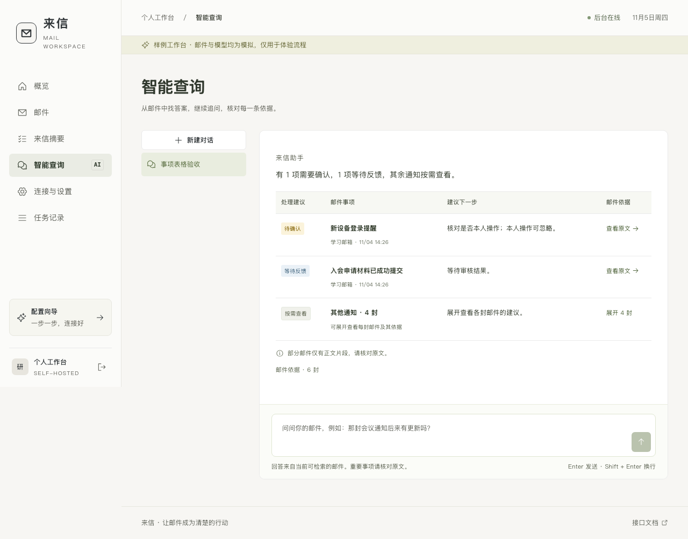
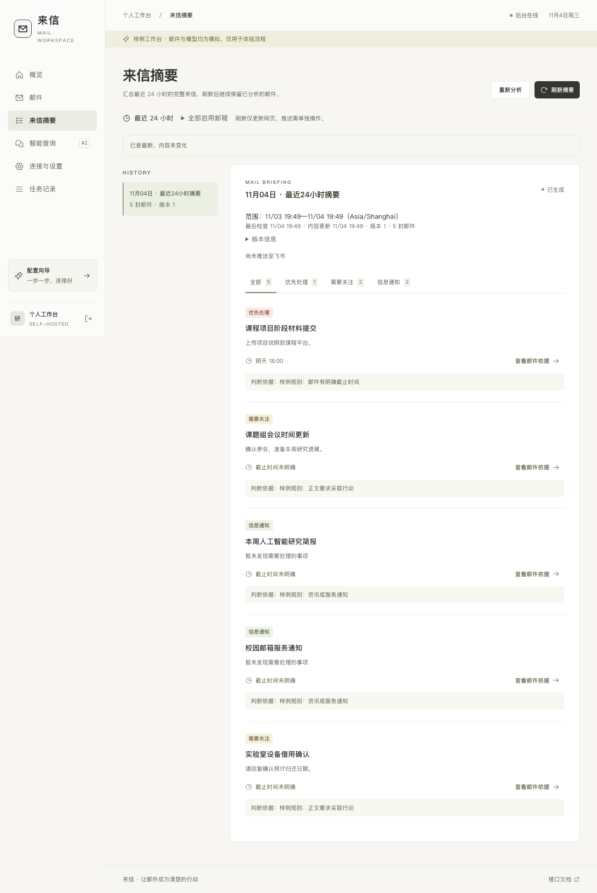

# 来信 · Mail Digest Agent

来信是一个可自托管的多邮箱智能工作台。把多个 QQ、网易邮箱接到一起，定时整理来信中的优先事项和截止时间，再用自然语言追问细节。需要时，可以让飞书机器人把摘要送到你的单聊。

[核心功能](#核心功能) · [快速开始](#快速开始) · [飞书消息](#飞书消息) · [开发说明](docs/development.md)



*智能查询的样例界面。截图中的邮件和回答均为演示数据。*

## 核心功能

| 功能 | 你可以做什么 |
| --- | --- |
| **多邮箱汇总** | 在同一个工作台配置多个 QQ、网易邮箱，选择要同步的文件夹，按来源筛选来信。 |
| **最近 24 小时摘要** | 手动刷新或设置定时汇总。摘要按优先处理、需要关注、信息通知分类，列出下一步、明确的截止时间和邮件依据。内容没变时复用已有版本。 |
| **带依据的多轮查询** | 问“今天有什么需要我处理？”或追问“那场会议后来改到几点？”。回答关联实际读取的邮件，可以点开原文和相关往来核对。 |
| **起草邮件回复** | 从摘要事项或邮件详情进入，输入想回复的要点。助手结合原邮件与关联往来起草回复，主题和正文可以编辑后复制。 |
| **飞书推送与对话** | 将摘要发到配对单聊，也可以直接向机器人提问。机器人先发接收提示，完成后回复结果，最终失败时说明原因。 |

### 摘要界面

从摘要里先看需要处理的事项，再点开邮件核对期限和判断依据。页面保留统计范围和历史版本，也会提示同步覆盖不足。



*最近 24 小时摘要的样例界面。*

## 快速开始

### 从源码体验

安装 Docker、Compose 和 Buildx，克隆仓库并启动演示工作台。

```sh
git clone https://github.com/ziguiway/mail-digest-agent.git
cd mail-digest-agent
MAIL_ASSISTANT_MODE=demo MAIL_ASSISTANT_HTTP_PORT=8766 sh deploy/up.sh -p mail-digest-demo
```

打开 [127.0.0.1:8766](http://127.0.0.1:8766/)，点击「进入演示工作台」。可以用样例邮箱体验摘要、原文查看、多轮查询和起草回复。

从源码启动真实工作台时执行 `sh deploy/up.sh`。脚本等待网页和后台通过健康检查，并打印访问地址与首次初始化凭证。[部署与网络排查](docs/deployment.md)

### 使用预构建镜像

已有镜像归档时，选用 AMD64 或 ARM64 版本，导入后用 Docker 启动。下面以 AMD64 为例，在归档所在目录执行。[镜像部署说明](docs/deployment.md#直接运行预构建镜像)

```sh
docker load -i mail-digest-agent-0.2.0-linux-amd64.tar.gz && docker run --pull=never -d --name mail-digest-agent --restart unless-stopped --stop-timeout 45 -p 127.0.0.1:8765:8765 -v mail-digest-agent-data:/var/lib/mail-assistant mail-digest-agent:0.2.0
```

打开 [127.0.0.1:8765](http://127.0.0.1:8765/)。首次进入时，用下面的命令读取一次性凭证，在网页设置管理密码。

```sh
docker exec mail-digest-agent mail-assistant bootstrap-token
```

### 接入自己的邮箱

1. 在网页配置支持工具调用和结构化输出的 OpenAI 兼容模型，并测试连接。
2. 添加 QQ 或网易邮箱，填写客户端授权码，选择需要同步的文件夹。
3. 按需设置每日汇总的时间、时区和邮箱范围。后台运行时，关闭网页后任务也会继续执行。

## 飞书消息

在「连接与设置 → 飞书连接」完成应用授权和单聊配对后，就可以发送 `/digest` 请求当前摘要，或者直接提问。简洁通知保留重点事项、下一步和来源，普通通知合并展示。下面是样例摘要的一段通知。

```text
【需要关注】课题组会议时间更新
下一步：确认参会，准备本周研究进展。
来源：课题组与实验室 · 课题组导师
```

启用每日汇总与飞书收发后，机器人也会按计划推送摘要。网页里的任务记录可查看生成与投递状态，并重试失败的投递。[飞书配置指南](docs/feishu.md)

## 技术与文档

网页由 React、TypeScript 和 Vite 构建，服务端使用 FastAPI 和 SQLite。邮件通过 IMAP 与邮件 MCP 同步，Agently 负责邮件检索和结构化分析。网页与飞书共用查询和摘要服务，Worker 负责调度和投递。

- [开发与测试](docs/development.md)
- [邮箱同步与缓存行为](docs/mailboxes.md)
- [Docker 和 HTTPS 部署](docs/deployment.md)
- [备份、恢复与旧配置导入](docs/maintenance.md)
