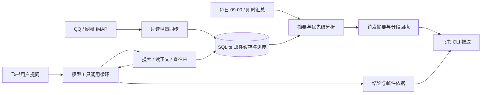

# CLI 原型使用说明

本文仅适用于保留的 `mail_agent/` 原型，以下命令均从仓库根目录执行。工程版使用 `mail_assistant` 命令、网页配置和独立数据目录，入口见 [README](../README.md)。

原型已完成离线演示和模拟接口测试；真实服务仍需使用自己的测试配置验证。

## 功能范围

- 配置多个邮箱，支持选择启用账号；预置 QQ、163，也允许填写自定义 IMAP 服务器。
- 通过 SSL IMAP 只读打开收件箱，用 `BODY.PEEK[]` 读取；提取文本／HTML 正文，忽略附件内容。
- 按账号和 UIDVALIDITY 保存 UID 增量进度，重启后继续同步。
- 每封新增邮件输出事项、行动、截止时间、三级优先级、判断依据和邮件来源。未明确的截止时间显示“未明确”。
- 每天 09:00（`Asia/Shanghai`）推送摘要；飞书发送“现在汇总一下”或 `/digest` 可即时汇总。
- 自然语言查询时，由模型选择搜索邮件、读取正文、查询往来三个工具；支持多轮追问并附上邮件依据。
- 飞书发送失败保留待发摘要，收到重复事件不重复处理；分段推送成功的部分记录回执。
- 部分邮箱读取失败、结果分页或正文截断时说明覆盖限制。

首版不包含附件分析、自动发邮件、删除邮件、个性化规则、安全专题实验或网页管理界面。

## 快速体验：无需任何账号

需要 Python 3.11 或更高版本，应用本身没有第三方 Python 运行依赖。在项目目录执行：

```bash
python3 -m mail_agent demo
```

保存演示结果：

```bash
python3 -m mail_agent demo --output examples/demo-output.md
```

演示包含三封近期样例邮件的优先级摘要，以及“找导师的会议通知 → 后来有没有更新”的连续查询，输出对应工具调用过程。演示数据写入临时数据库，运行结束删除，不混入真实邮箱数据库，也不会发送飞书消息。

## 连接真实服务

### 1. 创建本地配置

```bash
python3 -m mail_agent init
```

生成 `config.toml` 和 `.env`，已有文件不会被覆盖。编辑 `config.toml`：

```toml
[model]
base_url = "https://你的模型服务地址/v1"
name = "你的模型名称"
api_key_env = "MODEL_API_KEY"

[feishu]
cli = "lark-cli"
receive_id_type = "user_id"
receive_id = "ou_你的飞书open_id"
owner_open_id = "ou_你的飞书open_id"
```

保留模板中的其他字段，填写每个邮箱的 `email`，用 `enabled = true/false` 选择账号。`accounts.name` 是本地缓存的账号标识；更换邮箱地址时使用新的 name。

在 `.env` 填写：

```dotenv
MODEL_API_KEY=你的模型密钥
QQ_MAIL_AUTH_CODE=你的QQ邮箱授权码
NETEASE_MAIL_AUTH_CODE=你的网易邮箱授权码
```

模型需要支持 OpenAI 兼容的 `/chat/completions`、function tools 和 JSON object 输出。`base_url` 填到 `/v1` 一层，程序会追加 `/chat/completions`；如果供应商地址结构不同，以其兼容接口的基础地址为准。模型、密钥和接收人都由你配置，项目不内置可用凭据。

### 2. 开启邮箱 IMAP

在邮箱网页设置中开启 IMAP 服务并获取客户端授权码。这里填写授权码，不是网页登录密码。预置连接为：

| 邮箱 | IMAP 服务器 | SSL 端口 |
|---|---|---|
| QQ | `imap.qq.com` | 993 |
| 网易 163 | `imap.163.com` | 993 |

网易连接支持发送 RFC 2971 ID 客户端标识。如果仍然拒绝登录，需要按邮箱提示检查客户端授权和账号状态。真实账号兼容性须通过实际登录验证。

首次同步默认缓存最近 30 天，方便查“上周的邮件”；首次摘要只汇总最近 24 小时。后续新增邮件会继续缓存，并在成功发送摘要后标记已汇总。搜索范围是已缓存的、当前启用的邮箱文件夹，默认仅 `INBOX`，不包含垃圾箱、归档箱或未同步的历史邮件。

### 3. 配置飞书机器人和 CLI

当前开发机器已安装 `lark-cli 1.0.97`。其他机器需先安装并配置飞书 CLI，然后在自建应用中：

1. 开启机器人能力，将你自己加入应用可用范围。
2. 授予机器人发送消息、读取用户发给机器人的单聊消息所需权限，例如 `im:message:send_as_bot`、`im:message.p2p_msg:readonly`。
3. 配置 `im.message.receive_v1` 消息接收事件，按当前飞书 CLI 的指引配置事件通道并发布应用。
4. 在飞书中打开与机器人的单聊，配置自己的 open_id（`ou_...`）。

需要新建 CLI 应用配置时，先查看 `lark-cli config init --help`，再使用其配置向导；已有配置可直接沿用。不要在代码中填写应用 Secret，飞书认证由 CLI 管理。

`receive_id_type = "user_id"` 对应 CLI 的 `--user-id`，这里的值必须是飞书 **open_id**。如果配置指定聊天，则改成 `chat_id` 并填写 `oc_...`，同时明确填写 `owner_open_id`。

程序通过以下实际命令契约接入 CLI：

```bash
lark-cli event schema im.message.receive_v1 --json
lark-cli event consume im.message.receive_v1 --as bot
```

此 CLI 的接收事件已经扁平化，`content` 是可读文本，程序直接使用该字段。程序保持子进程 stdin 打开，收到 stderr 中的 ready 标记后才启动调度。

### 4. 检查、查询、预览

```bash
# 检查配置是否填写完整，不访问邮箱、模型或飞书 API
python3 -m mail_agent doctor

# 实际只读连接邮箱并同步
python3 -m mail_agent doctor --connect

# 只同步，不调用模型
python3 -m mail_agent sync

# 预览摘要，不发送、不更新摘要发送进度
python3 -m mail_agent digest

# 查询并显示工具调用过程
python3 -m mail_agent ask "今天有什么需要我处理的邮件？" --trace

# 终端连续追问
python3 -m mail_agent chat
```

仅查询某个邮箱：

```bash
python3 -m mail_agent --accounts qq ask "找一下上周的会议通知"
```

配置文件在其他目录时，将 `--config /完整路径/config.toml` 放在子命令前。

### 5. 启动飞书交互和每日推送

确认配置中的接收人后执行：

```bash
# 立即向配置的接收对象发送摘要
python3 -m mail_agent digest --send

# 常驻运行：每天 09:00 推送，同时接收并回复飞书查询
python3 -m mail_agent serve
```

在飞书中给机器人发：

- `现在汇总一下`
- `今天有什么需要我处理的邮件？`
- `找一下导师上周发的会议通知。`
- `那封邮件后来有没有更新？最终时间是什么？`

如果发件人的“导师”身份无法从邮件显示名和内容判断，提供其姓名或邮箱地址。项目没有预先配置身份关系。

调度在运行程序的设备上执行，需要设备和服务保持运行。当天 09:00 后启动会补执行当日汇总；飞书事件通道启动失败时服务报错退出，需修正配置后重启。当前项目没有自动安装系统后台服务。

如果服务已在运行，终端命令不能同时占用同一数据库；使用飞书查询，或停止已有进程后再操作。

## 工作流程



定时摘要使用固定流程；自然语言查询由模型根据已观察结果决定工具调用顺序。往来关联优先使用 `Message-ID`、`In-Reply-To`、`References`，相同标题只作为候选，不能直接证明是同一会话。

邮件同步进度与摘要发送进度分开保存。生成摘要不等于发送成功：先保存待发正文，收到全部分段的成功回执后才标记对应邮件已汇总。重试使用相同摘要与幂等键，并跳过本地已记录成功的分段。网络响应丢失时仍可能存在发送结果不确定的情况，不能承诺严格的 exactly-once。

## 测试与课程演示

```bash
python3 -m unittest discover -s tests -v
```

测试覆盖只读 IMAP、UID 增量与重置、失败续传、首次历史回填、MIME 解析、分页、邮箱范围、多轮工具调用、跨邮箱往来、部分同步失败、摘要进度、分段回执、重复事件和每日调度。HTTP 集成测试会启动本地模型替身，验证真实 HTTP 请求、JSON 摘要和工具调用回传；飞书监听测试使用可执行 CLI 替身验证 ready／NDJSON 契约。它们不依赖真实账号，也不证明真实模型质量。

建议演示顺序：

1. 展示 QQ 和网易中的测试邮件，一封行动通知、一封资讯、一组有时间变更的会议往来。
2. 预览摘要，核对事项、截止时间、优先级和引用来源。
3. 发送飞书摘要，再次汇总，检查已发送邮件不会作为新增邮件重复汇总。
4. 在飞书询问会议安排，再追问是否有更新，核对最终时间和来源。
5. 展示工具调用轨迹与调度测试，说明定时摘要和交互查询分别如何运行。

## 主要文件

| 文件 | 作用 |
|---|---|
| `mail_agent/mailbox.py` | IMAP 连接、只读同步、正文提取 |
| `mail_agent/store.py` | 邮件、会话、待发摘要与事件持久化 |
| `mail_agent/model.py` | OpenAI 兼容模型 HTTP 接口 |
| `mail_agent/agent.py` | 摘要分析、查询工具与回答依据 |
| `mail_agent/feishu.py` | CLI 发送、分段回执、事件监听 |
| `mail_agent/service.py` | 09:00 调度与消息任务处理 |
| `mail_agent/cli.py` | 初始化、检查、演示、运行命令 |
| `examples/demo-output.md` | 已生成的离线演示结果 |

可选安装到虚拟环境：`python3 -m pip install -e .`，然后使用 `mail-agent` 命令。直接从源码运行不需要此步骤。

实现依据：[Python IMAP 文档](https://docs.python.org/3.11/library/imaplib.html)、[QQ 邮箱授权码说明](https://help.mail.qq.com/detail/106/985)、[OpenAI 工具调用文档](https://developers.openai.com/api/docs/guides/function-calling)。飞书 CLI 参数与事件格式已对照本机 `--help`、`event schema` 和已安装的 lark-im／lark-event 技能确认。
