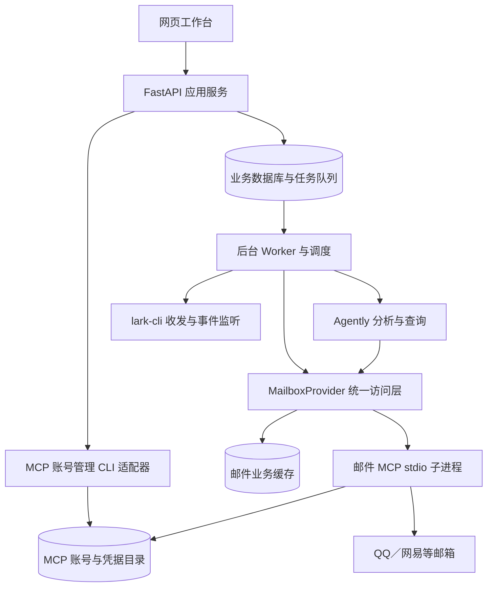

# 多邮箱智能体工程化升级规划 v2.2

更新日期：2026-11-04（Asia/Shanghai）。状态：工程版开发及真实联调准备中，尚未达到真实服务交付验收。

本版在已合并的[邮件 MCP 调研结论](../research/email-mcp-survey.md)上，补充可执行的剩余任务与真实服务验收表。维护互斥、旧配置导入、本地备份恢复、文件夹发现、缓存观察状态、独立移除连接及网页往来展示均已有实现和本地验证。状态依据现有源码和已记录的检查结果。本文件是本项目工程升级的主计划。项目位于 `/Users/zhengshuang/Documents/Codex/mail-digest-agent`。

## 0. 已确认范围与当前进度

已确认的产品方向保持不变：先实现实用的单用户多邮箱助手；提供完整中文前端和逐步配置引导，使用 Agently，优先接入 QQ／网易，支持网页摘要、多轮查询、后台运行和飞书交互。本轮不增加个性化、附件分析、多用户服务或网络安全研究专题，也不另立隐私研究模块。部署所需的基础登录与凭据管理仍属于实现工作。不设未经确认的交付日期。

采用两条可并行推进的路线：真实邮箱契约验证；使用明确标识的样例数据开发网页与业务流程。真实服务尚未通过的部分，不阻止界面开发，也不计为对应能力验收通过。

### 0.1 实施状态快照

以下“已落地”仅指存在相应实现；只有注明检查结果的部分有对应验证证据。

| 工作项 | 当前状态 | 完成前还需要什么 |
|---|---|---|
| 原 CLI 原型 | 保留，复查 19 项测试通过 | 工程版接入同等有效的行为检查；不能用原型测试代替新代码测试 |
| 依赖与工程目录 | 已建立后端包、前端目录、uv.lock、pnpm 锁文件 | 完成构建、部署与升级流程 |
| 数据与后台底座 | 已有迁移、持久任务、Worker、独立同步开关、数据库版本检查、问题提交去重和运行／维护锁 | 长期运行、完整部署恢复及真实服务验证；检查数量见验证记录 |
| 邮箱 MCP | 实际 CLI／stdio 本地检查通过；已补充收件时间／UID 快照、完整观察清单、缓存状态及文件夹发现；真实 CLI 离线账号生命周期包含移除与会话重建 | 真实 QQ／网易、文件夹兼容、删除／移动、UID 变化与大邮箱性能实测 |
| Agently | 已写结构化摘要、三个查询 Actions 和 TriggerFlow 流程 | 真实模型工具调用、多轮追问、输出异常及重试验证 |
| 样例后端闭环 | 临时独立数据库实测：2 个账号、6 封缓存邮件、5 项近期摘要；运行了实际 TriggerFlow | 样例正文及回答由规则模拟，不代表真实邮箱或模型通过 |
| Web 工作台 | 生产构建及 12 项浏览器测试通过；新增文件夹选择／重试、缓存状态筛选、往来跳转和连接移除确认 | 真实服务闭环、完整人工错误恢复与可访问性检查 |
| 飞书工程版 | 已实现独立配置／profile、原始链接与二维码、配对、机器人测试、共享查询服务、持久投递、断线及重启处理；16 项后端专项及对应界面契约测试通过 | 真实应用授权、权限、收发及连续运行实测；替身不计为真实平台通过 |
| 导入与恢复 | 已实现预检／续导入、维护锁、SQLite 快照和归档流；实际容器导入及新卷恢复通过，包含 MCP 发现、密钥解密、样例邮件与会话 | 真实邮箱／飞书凭据后端的恢复边界 |
| 容器与 HTTPS | Linux arm64 实际镜像构建、API／Worker、健康与重启、新卷恢复及本地 CA HTTPS／Secure 会话／SSE 均通过 | 公网 CA、已发布旧镜像升级回退、真实服务持续运行与远端 CI |

### 0.2 本次复查结果与证据边界

- `python3 -m unittest discover -s tests -v`：19 项通过，检查对象是原型 `mail_agent/`。
- 新后端在临时目录执行样例初始化与摘要任务成功，得到上表的 2／6／5 结果；临时数据库退出后删除。
- 前端 `pnpm build`、12 项 Chromium 浏览器测试和新后端 62 项测试已通过；OpenAPI 已重新生成。飞书包含 16 项专项检查，使用可执行 CLI 替身；实际 CLI 仅进行了离线二维码生成检查。完整命令范围见验证记录。
- 维护专项验证新目录恢复、已提交 WAL 数据、加密配置匹配、损坏／越界归档拒绝、跨进程互斥及 CLI 归档流；真实 MCP 空目录恢复后调用实际管理 CLI 检查配置。导入的故障续传使用隔离管理替身，不登录邮箱。对运行中的样例服务执行备份也被正确拒绝。
- 邮件 MCP 的握手、工具发现、Agently 注册与 16 项上游模拟测试证据详见[调研记录](../research/email-mcp-survey.md)。这些不证明真实账号兼容。
- 11 月 3 日时，真实模型、真实邮箱、工程版飞书和 Docker 运行均尚未验收，见当日[本地验证记录](../verification/2026-11-03-local-checks.md)；Docker 的后续进展见下方。

11 月 4 日已补充实际容器构建／运行与本地 CA HTTPS 证据，修复 CLI 安装缺少 curl 和恢复目录权限问题；详情见[部署验证记录](../verification/2026-11-04-deployment.md)及[检查结果](../verification/2026-11-04-container-checks.json)。前述 11 月 3 日记录保留其当时的验证范围。当前真实入口为 `http://127.0.0.1:8877`，用户已选择开始配置专用测试账号；尚未取得真实服务通过证据。

### 0.3 接下来按此顺序推进

1. 等待用户在已运行的真实入口完成模型、QQ／网易和飞书配置，验证真实读取、分析与收发，并处理实际兼容问题。
2. 核对真实认证恢复，补充已发布版本镜像的升级回退演练，以及具备域名／仓库条件后的公网 CA、远端 CI 记录。
3. 完成至少 24 小时且跨过 09:00 的真实配置连续运行验收。

真实服务联调需要用户在网页配置有效凭据并完成平台操作。其间继续完成可独立进行的检查和交付整理。恢复见[维护说明](../maintenance.md)，邮箱行为见[文件夹、缓存与连接生命周期](../mailboxes.md)，部署与课堂步骤见[HTTPS 部署](../https.md)和[课程演示](../demo.md)。

### 0.4 本次明确的工程决策

- 邮箱接入采用“应用统一接口 + 邮件 MCP 适配器”。QQ／网易先走 IMAP；MCP 是应用调用邮箱工具的协议层，不替代 IMAP，也不自动提供完整产品。
- 继续验证已接入的 `Wh1isper/mcp-email-server`，不同时集成多个邮件 MCP。其他候选保留在调研文档中，仅在明确契约缺口时重新评估。
- 前端统一负责配置体验；账号增改与连接测试由后端封装管理 CLI，邮件读取由 Worker 管理的 MCP 会话执行。
- Agently 负责摘要分析与带来源的查询；连接管理、同步、调度、重试和发送回执由应用服务确定性执行。本期不新增多智能体协作。
- 当前按单用户、两个服务、一个共享数据卷交付，不引入 Redis、独立消息队列或远程 MCP 服务。扩展服务商使用同一适配边界，本期真实验收以 QQ／网易为准。

### 0.5 剩余工作与关闭条件

下表跟踪交付条件。R1 已实现并通过本地验证；R2 已通过本地数据恢复检查，仍待真实认证恢复验证；R3、R4、R5 已实现并完成本地契约／样例浏览器检查，真实服务部分随 R7 验收。R6、R7、R8 尚未关闭，不以本地通过替代整体交付。

| 编号 | 交付内容 | 主要改动位置 | 关闭条件 |
|---|---|---|---|
| R1 | 维护互斥与旧配置导入 | CLI、配置应用服务、数据库 | API／Worker 运行时拒绝离线维护；TOML／.env 导入可预检、可恢复、重复执行不新增账号，原文件不变 |
| R2 | 一致性备份与恢复 | CLI、存储适配、部署文档 | 新数据目录恢复成功；业务库、应用密钥、MCP 目录及飞书凭据引用一致；损坏归档在写入目标前被拒绝 |
| R3 | 文件夹发现与选择 | MailboxProvider、Worker 任务、账号 API、邮箱表单 | 页面显示真实返回的文件夹；中文名称及选择值往返不变；切换后重新验证并重建同步范围 |
| R4 | 缓存状态与账号生命周期 | 同步服务、数据迁移、邮件 API／页面 | 当前观察、历史缓存与未确认状态可区分；部分结果不推断删除；停用和移除连接语义分别实现 |
| R5 | 邮件相关往来与恢复体验 | 邮件详情、查询页、任务页 | 从答案／摘要打开来源后能查看引用关联的往来；标题候选明确标识；刷新和失败重试可继续查看进度 |
| R6 | 可运行部署与升级回退 | Compose、反向代理示例、CLI、CI | 空卷部署、HTTPS 配置、重启、迁移和备份回退都有实际验证记录；远端 CI 状态可核对 |
| R7 | 真实服务联调 | 邮箱／模型／飞书配置与验证记录 | 下文验收表分别记录 QQ、网易、模型和飞书结果，不能以样例或替身测试关闭 |
| R8 | 连续运行与交付材料 | Worker、运行记录、README | 真实配置运行至少连续 24 小时，跨过一次 09:00 调度；记录重启／断线恢复、重复与漏处理情况；README 以工程版为主入口 |

依赖关系：R1 的维护互斥是 R2 的前提；R3 与 R4 共同约束同步范围；R5 可使用样例推进，但最终依赖真实来源验证。R6 可在 R7 前验证容器底座；R8 依赖 R6、R7。24 小时是最低运行验收窗口，不是交付日期或可用性保证。

## 1. 产品目标与技术架构

交付单用户自托管的中文 Web 工作台，以 Docker Compose 部署。用户通过网页配置和使用邮箱助手，飞书作为可稍后绑定的摘要推送与对话入口。保留只读多邮箱接入、三级优先级、每日汇总、多轮查询与邮件来源依据。

技术选型：React、TypeScript、Vite、React Router、TanStack Query；Tailwind CSS 与基于 Radix 的 shadcn/ui；Python 3.11、FastAPI、Pydantic 2；Agently；SQLAlchemy 2、Alembic、SQLite WAL；独立 Worker 与 APScheduler 3；官方 lark-cli。

主要调整：将邮箱访问改为可替换的 MailboxProvider，优先验证并复用 Wh1isper/mcp-email-server。基础连接、协议兼容与正文解析由邮件 MCP 提供；应用负责配置体验、跨账号聚合、业务缓存、分析、调度与推送进度。

锁定本次已检查的兼容性基线：Agently 4.1.4.10、mcp-email-server 1.14.0、FastMCP 3.4.11、MCP Python SDK 1.30.0。依赖进入 uv.lock，前端使用 pnpm 锁文件。版本升级先经过契约与回归检查。

目标运行方式采用 Worker 管理的 stdio MCP 子进程，维持 API、Worker 两个运行服务。工程版当前已接入 MCP 适配器，但它仍是待实测的候选后端，不据此宣称已支持真实 QQ／网易。当前单用户部署不增加独立远程 MCP 服务。未来需要独立部署时，由适配器支持内网 Streamable HTTP。

## 2. 用户界面与配置流程

使用 minimalist-ui 技能设计中文工具工作台。暖白背景、深灰文本、细分隔线，低饱和颜色表达优先级与连接状态，中文系统字体和 Phosphor 图标。桌面侧栏、窄屏抽屉；优先完成向导、摘要页、对话页三个关键界面，再扩展其余页面。

首次向导依次为：

1. 初始化管理入口：使用部署时生成的一次性凭证设置管理密码，后续使用登录会话。
2. 配置模型：填写服务地址、模型与密钥，分别验证结构化摘要和工具调用能力。
3. 添加邮箱：选择 QQ、网易或自定义 IMAP，自动填入服务器参数，展示授权码获取说明；后端封装 MCP 管理 CLI 的账号新增与连接测试，至少验证一个账号。
4. 设置摘要：选择账号、时间、时区；默认每天 09:00、Asia/Shanghai，初次回溯 30 天、首次摘要覆盖最近 24 小时，后台默认每 5 分钟同步。
5. 首次试运行：展示同步与分析阶段，生成网页摘要；用户明确启用定时计划。
6. 绑定飞书或跳过：未绑定时，日常摘要保存在网页，配置界面显示飞书尚未启用。

向导保存草稿、支持返回修改与刷新恢复；明确区分已保存、待验证、验证通过和失败。修改连接参数或密钥后重新验证，失败时保留表单并提供可执行的修复建议。

非敏感表单草稿可恢复，密钥与授权码不写入浏览器草稿；尚未提交的凭据刷新后提示重新填写。后端对配置记录版本，测试结果绑定被测试版本，防止旧配置测试较晚返回后把新配置误标为通过。启用计划是单独操作，向导完成不自动代替用户启用。

六个主入口：概览、邮件、摘要、智能查询、连接与设置、任务记录。邮件提供跨账号筛选、正文详情与相关往来；摘要保存结构化事项并展示优先级、截止时间、依据及生成／推送的独立状态；查询展示阶段进度、回答与可点击的邮件来源。补齐空状态、加载、部分成功、错误恢复、键盘操作和减少动画模式。

MCP 自带 UI 仅作为账号管理实现参考；我们的用户使用统一工作台，无需填写 MCP JSON、编辑 TOML 或运行命令行。上游 Web UI 的连接测试说明存在文档差异，实际测试统一由我们的后端调用已核实的管理 CLI 完成。

## 3. 接口、账号与智能体职责

项目采用单仓库：apps/web 管理前端；backend/src/mail_assistant 按 API、应用服务、领域模型、适配器、智能体和 Worker 分层；deploy 存放构建与部署配置。提示词与输出契约独立管理。

### 邮箱访问与账号管理

- MailboxProvider 至少提供账号发现、连接测试、文件夹发现、分页元数据检索和批量正文读取能力。首选 McpMailProvider；原型 IMAP 实现保留为显式诊断备选，不在运行失败时静默切换。
- 同时支持同一服务商的多个账号。应用稳定账号 ID 对应上游 account_name，界面昵称修改不改变同步身份；每次 MCP 调用明确账号和文件夹，应用再合并结果并保留来源。
- 邮箱账号与授权码通过上游受支持的管理 CLI／JSON 接口写入 MCP 账号目录；密码经 stdin 传入。应用保存账号引用、业务设置与验证状态，不维护第二套生效的邮箱密码。
- API 容器执行有边界的账号管理命令，Worker 独占邮件 MCP 的读取会话；双方使用同 UID、共享持久化 MCP 状态目录。配置变更按上游 revision／restart_required 处理，必要时由 Worker 有序重连。
- 不直接读写上游私有 SQLite 表，也不把上游元数据投影当作完整邮件正文缓存。业务库保存需要的邮件、来源引用、摘要、会话和执行记录。
- 同步按服务商收件时间、分页及已核实的 UID 状态建立覆盖记录，使用重叠扫描与去重处理边界；绝不以返回的 Date 头代替 INTERNALDATE 游标。完整 UID 状态未通过公开 MCP 返回时，在独立适配模块补充暴露上游已有只读快照／增量能力，并加契约测试。
- 超过上游元数据窗口、返回部分结果或无法确认完整性时，保存并展示覆盖限制，不把查询失败或不完整结果解释成无邮件。缓存中保留历史记录，并区分历史缓存与当前邮箱观察状态。

**同步实现与待验证项：**已在独立模块中增加 `workspace_mailbox_snapshot` 和 `workspace_mailbox_state`，通过上游提供者接口取得 INTERNALDATE／UID 状态，冻结分页并在正文读取后重新核对状态。增量时间窗口和完整观察清单分别处理，保存每封缓存的状态、UID 代际及最近观察时间；只有完整覆盖才推进水位，未知收件时间不进入近期摘要。历史缓存与尚未确认状态已提供网页筛选、详情说明和模型查询字段。以上已通过合成契约与实际 stdio 工具发现检查，仍需真实邮箱验证；分页读完或总数稳定都不能单独证明完整性。

轻量扩展保持独立适配边界，不修改上游私有数据库。优先验证上游现有只读接口能否补齐字段；若锁定版本确实无法提供所需语义，记录契约缺口，显式选择原型 IMAP 适配路线继续真实邮箱交付。切换选择与原因写入配置和验收记录，不做静默回退。

账号停用需要同时落实到应用任务选择和上游目录状态，重新启用、授权码轮换、文件夹变更后有序重建读取会话。停用保留历史邮件和摘要引用；界面把“停用”与“移除连接”分开命名，移除连接不得顺带清空历史。接口与页面行为需一致。

**账号与邮件状态的补齐要求：**

- 文件夹发现返回服务商原始标识与展示名称；用户选择后保存原始标识。发现失败要显示具体状态并允许重试，不能将失败显示为空文件夹列表。默认选择 INBOX，本期每个账号选择一个同步文件夹。
- 同步身份至少包含稳定账号 ID、文件夹和 UIDVALIDITY；UID 仅在该身份内有效。修改文件夹或 UIDVALIDITY 变化后重新建立观察范围，保留原邮件及摘要引用。
- 邮件状态区分“当前观察到”“历史缓存”“尚未确认”。只有范围完整且前后状态一致的观察才能判断该范围内旧缓存不再出现；增量窗口外的邮件、部分结果和连接失败不能据此标为已删除。历史缓存不等同于已从服务商删除。
- 邮件列表、详情和模型搜索结果均携带账号、文件夹、缓存状态及最后观察时间。默认查询范围和历史缓存的包含规则保持一致，并在结果中说明覆盖限制。
- 当前 `DELETE /accounts/{id}?expected_revision=...` 已执行独立移除；停用保留为单独接口与网页开关。移除先持久化停止使用的意图，取消尚未开始的显式账号任务，再调用上游公开移除命令；结果未确认时保持停用并允许重试。历史邮件及往来可通过旧来源只读打开，普通查询仍限于启用账号。网页相关往来已显示引用关联与同标题候选，并可跳转和返回。

### Agently 与业务编排

- 结构化分析提取事项、行动、截止时间、优先级、判断依据与邮件来源，Pydantic 校验通过后保存；未明确的信息不补造。
- 查询模型只获得搜索邮件、读取正文、关联往来三个应用级 Actions，适配层使用缓存或 MCP；邮件 MCP 配置 allowed_mutations=[]，并限制向模型暴露的工具。21 个上游工具不会全部作为产品能力开放。
- 往来关联使用 Message-ID、In-Reply-To、References，标题相同仅作为候选；网页与飞书共享查询服务，分别保存各渠道会话上下文。
- TriggerFlow 编排同步、收集待汇总邮件、分析、保存结果、可选推送。后台同步与重试由 Worker 确定性执行，不依赖模型临时规划。
- 每次请求建立独立执行上下文。业务数据库作为最终状态来源，Agently 执行记录用于诊断。当前版本异步 MCP 接入使用已验证的 async_use_mcp，显式包含 FastMCP 依赖；产品查询优先通过应用级 Actions 封装访问。

### Web API

统一 /api/v1，提供初始化与登录、向导、连接、邮件、摘要、会话、任务接口。同步、连接测试、摘要、问题提交返回后台任务 ID；SSE 提供阶段进度、最终结果及错误，刷新后按事件游标恢复任务查看。本期不以逐字流式回答为验收前提，后续如实现则增加独立事件类型；当前阶段事件不能标作模型答案增量。

邮件来源返回稳定本地 ID，前端打开只读详情；摘要保存结构化条目，由网页与飞书分别渲染。OpenAPI 生成前端类型化客户端。密钥字段不回显，配置更新后后续任务使用新配置。

## 4. 后台任务、飞书与部署

API 处理交互，Worker 处理长任务、调度、邮件 MCP 和飞书监听。关闭网页不影响任务运行，飞书连接失败也不阻止网页查询或生成摘要。

- APScheduler 仅在一个 Worker 中运行，计划从业务数据库恢复，定时任务使用唯一执行标识避免重复创建。
- 任务先持久化再执行；查询和后台汇总分别保留一个执行通道。同账号同步互斥，可复用正在进行的同步结果。
- 暂时性错误最多重试三次；授权失效进入需重新配置状态。重启后根据阶段记录恢复，保留摘要正文、分段发送回执与待处理事件。
- 摘要生成与发送分别记录状态；飞书未配置时标记未启用，已配置但发送失败时标记待重试。发送结果不确定时明确展示，不能承诺严格只发送一次。

后台同步与“每日摘要是否启用”分别配置：关闭每日摘要后，已启用的后台同步仍可运行。当前已拆开开关，并验证停用被选账号后不会意外扩大到其他邮箱；仍需验证修改时区、时间、暂停与重启后的完整运行行为。

摘要生成采用任务提交时固定的最近 24 小时范围及邮箱／文件夹范围，按服务器收件时间查询完整集合，不以“是否已汇总”消耗邮件。单封分析缓存、按日期与来源分组的不可变摘要版本、每次范围检查及飞书投递分别保存；重复刷新保留完整内容，没有内容变化时复用版本。旧版增量摘要和空记录保留并折叠。详见[摘要刷新设计](digest-refresh-redesign.md)及其验证记录。推送失败重发既有摘要，跳过已获成功回执的分段；不能依赖“邮件仍未汇总”重新调用模型生成另一份摘要。网页与飞书查询的用户消息、任务和回复通过稳定请求标识关联，避免重试留下重复消息。

飞书完整引导：专用 CLI profile → 创建／绑定应用 → 展示 CLI 原始链接及二维码 → 引导权限、事件订阅和发布 → 等待消息通道 ready → 用户发送网页生成的配对码 → 绑定实际 sender_id／chat_id → 用户点击发送测试消息。处理过期、取消、重新绑定和监听重连；平台要求用户完成的步骤明确说明。

当前已按上述路径实现，见[飞书操作与恢复说明](../feishu.md)。新增独立授权、投递任务通道；摘要与回复先形成持久投递记录，按分段保存成功回执。无回执或重启时遗留的发送中分段进入结果不确定状态，由页面提供核对后的明确重试。重新配对创建新的接收绑定，旧投递不转移目标。以上已通过替身和界面契约测试，M3 仍待真实平台与连续运行验收。

Compose 默认 API、Worker 两个服务，使用同一套构建产物；API 同源提供前端静态资源，Worker 包含邮件 MCP 与飞书 CLI。持久化业务数据库、MCP 状态、飞书配置和应用密钥；默认本机访问，提供服务器反向代理与 HTTPS 示例。加入健康检查、Worker 心跳、结构化日志、备份与恢复命令。

保留原 CLI 演示与诊断，提供旧 TOML／.env 一次性导入并保持原文件。旧配置中的邮箱凭据导入 MCP 目录，其他业务设置导入应用配置；显式记录导入结果，避免新旧配置同时生效。

### 导入、备份与运行维护的具体要求

以下导入、离线维护、备份与新目录恢复已实现，并已通过实际容器新卷恢复；命令见[维护说明](../maintenance.md)。HTTPS 示例及本地 CA 链路已验证。外部凭据、公网 CA 与已发布旧镜像升级回退仍需单独实测。

1. **维护边界。** API、Worker 持有运行共享锁，导入、备份和恢复申请独占维护锁。存在活动进程时返回停止服务的操作提示，不在写入中复制数据；维护结束前不启动任务或发送消息。先按离线维护交付，不要求在线热备份。
2. **旧配置导入。** 明确传入 TOML 和可选 .env 路径，先预检邮箱、模型与计划字段；不执行配置内容、不覆盖进程环境。缺失环境变量只报告名称，不输出凭据。保存来源指纹和导入记录，部分失败后可继续，重复执行不生成重复账号，也不静默覆盖已有配置。新导入连接先验证，定时计划保持关闭；旧飞书目标作为配置提示，仍走网页配对与测试。
3. **一致性备份。** 归档包含业务数据库、应用密钥、MCP 状态与账号目录、飞书配置和必要凭据，并附格式版本、应用版本、文件清单与校验值。SQLite 使用受支持的备份机制，不仅复制主文件。排除锁、临时文件和可重建缓存，归档不写入被备份目录。
4. **恢复到新目录。** 写入前校验归档、路径和全部校验值；拒绝覆盖已有工作空间。通过公开配置机制重建目录相关引用，不直接修改上游私有表。检查数据库完整性、解密能力、账号引用及配置状态；恢复后先展示状态，服务启动后再按持久任务规则恢复执行。未知发送结果保持待核对，不因恢复自动重发。
5. **凭据可迁移性。** 验证 MCP／飞书实际使用的凭据后端及其是否依赖系统钥匙串。若凭据位于数据卷之外，备份报告必须列出未包含项和恢复时需重新授权的步骤；只有在新目录证明可解析时才记为完整凭据恢复。不能以“已复制 profile”推断认证已恢复。
6. **升级与回退。** 固定镜像和依赖版本；停止写入、备份、升级、检查迁移与健康状态。回退使用升级前镜像和对应备份，不要求旧版本直接读取新数据库。HTTPS 示例明确域名、代理头、登录会话及 SSE 连接要求，并实际验证。

## 5. 实施里程碑与验收

里程碑按验收结果推进，不按代码量或页面数量标记完成。M0 的真实服务验证可与 M1／M2 的样例开发并行；真实网页闭环依赖 M0 和 M1，M3 依赖共享的网页查询／摘要服务，M4 汇总全部运行证据。当前 M0、M1、M2 均为进行中；M3 已有实现和模拟验证，待真实验收；M4 部分实现、尚未验收。

### M0：锁定邮件 MCP 访问契约与真实兼容性

用专门 QQ、网易账号验证双账号发现、中文检索、HTML／中文编码、分页、正文与引用头、读取前后已读状态、精确时间边界、授权码更新、单账号失败和进程重启。重点验证超过 1,000 封的邮箱、元数据窗口覆盖，以及公开工具是否提供完整同步所需状态；缺失部分按第 3 节补充轻量适配后复测。

通过后将 MCP 设置为默认访问后端；未通过时记录具体阻塞，继续用原型适配器开展页面与业务开发，不宣称真实邮箱已兼容。当前已完成 MCP 握手／工具发现、Agently 注册和 16 项上游模拟测试，这些不代替本阶段实测。

### M1：工程底座与统一服务

建立新项目结构、数据库迁移、配置服务、MCP 生命周期管理、账号管理适配器、持久任务与结构化摘要契约。完成从旧配置到 MCP 账号目录及应用设置的导入。用真实模型验证三个应用级读取 Actions。

验收产物：新后端专项测试与执行结果，覆盖初始化与会话、账号生命周期、配置版本、任务领取与恢复、来源范围、部分同步、摘要重复提交和投递状态分离。现有底座实现与原型 19 项通过不足以关闭本阶段。

### M2：完整网页使用闭环

完成中文配置向导、模型与邮箱测试、首份摘要、邮件详情、历史摘要、多轮查询和任务记录。飞书跳过后可独立使用；关键页面按 minimalist-ui 设计并进行浏览器检查。

验收产物：`pnpm build` 通过，桌面与窄屏浏览器检查记录、关键流程 Playwright 结果。检查首次用户与返回用户、刷新恢复、键盘操作、文字对比度、空数据、单账号失败、Worker 离线、SSE 断线恢复；真实服务与样例数据分别记录。

### M3：飞书与连续运行

完成网页引导绑定、配对码、收发验证、09:00 调度、邮件同步、断线重连、失败重试与重启恢复。查询与后台任务互不长期阻塞。

验收产物：工程版的绑定／解绑与配对过期测试、CLI 替身契约测试、真实收发记录、分段投递故障与重启恢复记录。真实发送前，网页明确展示已配对的接收对象和用户触发的测试／启用动作。

### M4：部署与验收交付

完成 Compose、安装说明、备份恢复和升级流程。迁移现有 19 项原型测试中有效的行为检查，补充 MCP 适配契约、账号配置生命周期、API、Playwright 和容器测试。真实服务联调单独记录。

验收产物：可构建镜像、`docker compose up` 的全新部署与重启检查、备份恢复到新数据目录后的验证、旧配置导入报告、升级与回退说明。备份必须一致地包含业务数据库、MCP 状态、飞书 profile 与应用密钥；可先停止写入后备份，不能直接复制正在写入的 SQLite 主文件并宣称完整备份。

交付时保留一份验收表，逐项记录命令或操作、环境、结果、失败原因与待补条件；“未执行”“模拟通过”“真实通过”分开列示。缺少 Docker 或真实凭据时明确记录未验收项，继续完成其余实现，不将其改写为已通过。

最终验收：

- 新用户通过网页完成配置，日常使用无需编辑文件；多个 QQ／网易账号可独立启停和测试。
- 网页关闭后后台继续执行，页面状态反映实际 Worker／连接状态。
- 摘要可核对事项、截止时间、优先级与依据；未知信息、部分同步与正文截断明确可见。
- 多轮追问可找到会议更新，并打开对应往来邮件。
- 账号增删、授权码轮换、模型设置与时间修改后，新配置正确生效，不跨账号混用状态。
- 用户刷新、服务重启、单账号失效、飞书中断、超出缓存窗口和发送结果不确定都有可解释、可恢复的行为。
- 模拟测试、协议检查、真实邮箱测试和真实模型联调分别报告，不合并成未经验证的整体可用性结论。

## 6. 真实服务验收与交付记录

用户通过本地网页填写有效模型密钥、邮箱授权码，并完成飞书平台要求的授权／权限／发布／配对动作。开发阶段继续使用隔离样例和替身，不预先操作用户真实邮箱或发送消息。正式联调沿用网页中明确触发的连接测试、试运行和消息测试。

| 验收对象 | 最低操作与可核对证据 | 当前状态 |
|---|---|---|
| QQ | 专用账号连接、中文搜索、正文与引用头、读取不改变已读状态、授权码更新；保存脱敏操作记录 | 未执行 |
| 网易 | 专用账号连接与服务商握手、中文／HTML／编码、正文与引用头、读取状态、授权码更新 | 未执行 |
| 多账号 | QQ＋网易同时启用；同服务商两个账号独立配置；单账号失效时其余账号可用，摘要来源不混淆 | 未执行 |
| 同步正确性 | 新邮件、文件夹切换、移动／删除、超过元数据窗口、UID 状态变化；核对覆盖与缓存状态 | 未执行 |
| 真实模型 | 结构化摘要及三个读取 Actions，多轮追问打开来源；异常输出和超时可恢复 | 未执行 |
| 真实飞书 | 授权、配对本人、测试消息、摘要及查询回复、断线与重启；逐项记录实际回执 | 未执行 |
| 容器与恢复 | 空卷启动、健康检查、停止／重启、恢复到新卷、HTTPS 与升级回退 | 前五项及本地 CA 通过；公网 CA 和已发布旧镜像回退待验收 |
| 连续运行 | 至少 24 小时且跨一次 09:00 计划，核对计划记录、摘要、发送回执和故障恢复 | 未执行 |

记录不得包含邮箱授权码、API Key、应用 Secret 或完整私人邮件。最终交付为源码与锁文件、主计划、安装／使用／恢复说明、已执行的验收记录，以及课堂演示步骤。验收记录保留失败和未执行项；材料齐全不替代功能通过。
